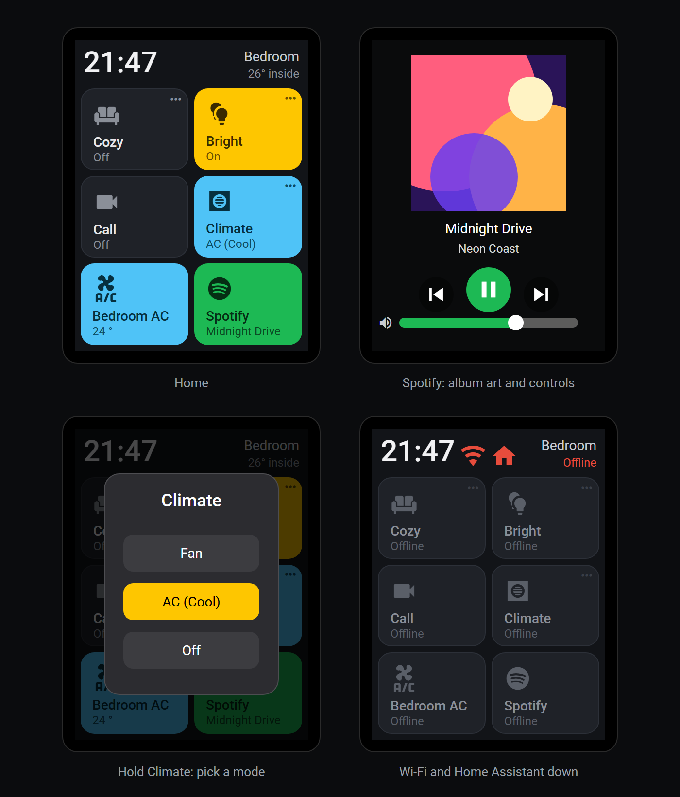

# CYD Home Assistant Panel

An ESPHome + LVGL firmware that turns a $15 ESP32-2432S028 "Cheap Yellow Display"
into a dark, glanceable Home Assistant control panel for your desk.



*Rendered from the firmware's own fonts, icons and layout values. The album cover shown is placeholder artwork.*

## Features

- **2×3 tile grid**: lights, switches, scenes, scripts, fans, covers, climate and a
  Spotify / media player tile. Each tile shows an icon, a title and a live status line.
- **Colour means state**: tiles are dark when off and filled with a per-category
  accent when on (lights yellow, climate cyan, media green).
- **Hold for more**: tiles marked with `•••` open a picker or slider on long-press:
  brightness, colour and colour temperature, fan speed, cover position, a thermostat,
  or a custom list of actions with the current option highlighted.
- **Spotify overlay**: album art, track and artist (including Chinese titles),
  play/pause, previous/next and volume. Holding the Spotify tile toggles between
  mute and full volume, with a muted indicator on the tile.
- **Header**: large clock, room name and room temperature.
- **Honest connection state**: Wi-Fi and Home Assistant icons appear only when a link
  is down, and every tile turns grey and reads "Offline" while Home Assistant is
  disconnected.
- **Auto-dim**: dims after inactivity, with a separate night-time level.

## Hardware

- ESP32-2432S028 (CYD), 2.8" 240×320 touchscreen, 4 MB flash, no PSRAM
- Display: this config uses the ST7789 variant (`mipi_spi` model
  `ESP32-2432S028-7789`). Some boards ship ILI9341 instead; change `model:` if the
  image is garbled.
- Touch: XPT2046 (resistive)

## Setup

1. Install [ESPHome](https://esphome.io) 2026.4 or newer.
2. Copy `esphome/secrets.yaml.example` to `esphome/secrets.yaml` and fill in your
   Wi-Fi details and API encryption key. `secrets.yaml` is gitignored.
3. In `esphome/home-like.yaml`, edit the `substitutions:` block:
   - `ROOM_NAME`, `TIME_24H`, `HA_BASE_URL`
   - `TILE1_…` to `TILE6_…`: the Home Assistant entity, title, icon, type and colours
     for each tile. Every option is documented in
     [`esphome/docs/TILE_CONFIGURATION.md`](esphome/docs/TILE_CONFIGURATION.md).
   - Optionally uncomment `manual_ip` for a static address.
4. Flash over USB:
   ```bash
   esphome run esphome/home-like.yaml
   ```
   The partition table (`esphome/partitions.csv`) uses a single app partition to
   fit the CJK font subset, so there is no OTA slot: updates go over USB.
5. Adopt the device in Home Assistant, then enable **Allow the device to perform
   Home Assistant actions** under Settings → Devices & services → ESPHome →
   the device → Configure. Without it, taps can't control anything.

### Album art (optional)

Spotify's own cover is about 100–250 KB, more than this board can buffer. Instead,
Home Assistant serves a scaled-down copy through a camera entity:

1. Settings → Devices & services → **Add integration** → **Generic Camera**.
2. **Still image URL** (use your own media player entity):
   ```
   http://127.0.0.1:8123{{ state_attr('media_player.spotify', 'entity_picture') or '/static/icons/favicon-192x192.png' }}
   ```
   Leave the stream source and credentials empty.
3. Set it up **while Spotify is playing**. Home Assistant records the image type
   from the preview, and it only resizes JPEGs; if you set it up while idle, open
   the camera's options and save them again while something plays.
4. Name the device so the entity is `camera.spotify_album_art`, or change
   `SPOTIFY_ART_CAMERA` in the substitutions.

The panel requests `camera_proxy/...?width=160`, which comes back as a ~3–7 KB,
160×160 JPEG. If the camera doesn't exist, the overlay just shows a placeholder.

### Tiles in this config

The included config is a real bedroom setup and is meant as a worked example:
Cozy / Bright / Call trigger lighting automations, Climate picks a mode from an
`input_select`, Bedroom AC is a `climate` entity, and the last tile is Spotify.
Tiles 1, 2 and 4 have custom long-press pickers (search the YAML for
`cozy_scene_overlay`, `ceiling_light_overlay` and `hvac_mode_overlay`); point them
at your own entities or remove them. Holding tile 6 toggles the Spotify volume.

## Credits

- Built on [akuehlewind/ESPHome-touch-display-mount](https://github.com/akuehlewind/ESPHome-touch-display-mount)
  (MIT, see [`UPSTREAM_LICENSE.txt`](UPSTREAM_LICENSE.txt)).
- [Material Design Icons](https://github.com/Templarian/MaterialDesign-Webfont)
  webfont, Apache 2.0.
- Roboto and Noto Sans SC/TC fonts are pulled from Google Fonts at build time.
